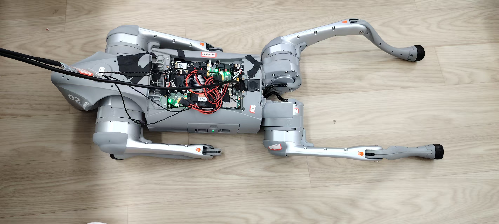

# Go2 关节标定

本工具通过 K3 直连电机的 BRAKE 反馈计算零偏。直接运行进入 Pose X/Y/Z 终端交互，
依次采集、计算并预览结果；最后输入“确认标定”才写入本机配置。原来的 Pose E 和分阶段
采集、离线合并命令继续可用。

## 终端交互标定

先停止 Go2 主程序及其他电机串口程序，支撑好机身。在构建安装后的板端执行：

```bash
cd /root/spacemit_robot
systemctl stop go2-sdk.service
source output/staging/setup.bash
python3 output/staging/lib/unitree_go2/tool/1.calibration/calibrate_robot.py
```

脚本依次提示摆到 Pose X、Y、Z。每次摆好后按回车，倒计时 **5 秒**才开始采集；
记录期间保持姿势。某阶段采样不稳定或反馈异常时，会提示重摆并重采该阶段。
串口启动时首帧超时会最多重试 3 次，成功后仍采满 20 帧新的有效反馈；持续超时或异常反馈会中止并记录具体错误。
三组采集并校验完成后，终端提示可以松手、放稳机器狗，然后显示 12 个关节的新旧零偏
和 Pose A 转子参考。

原始采样及 `calibrated.yaml` 默认保存在 SDK 的 `output/calibration/poseXYZ-<时间>/`。
最后输入“确认标定”才更新 `/etc/unitree-go2/robot.yaml` 中的零偏和启动转子参考，其他
本机配置保持原值；直接回车仅保留结果，不应用。摆姿阶段输入 `q` 或按 `Ctrl+C` 可退出。
确认后的标定在下次启动生效，启动前恢复 Pose A。

`GO2_LOCAL_CONFIG` 或 `--base-config` 可指定本机 YAML。需要指定新的采集目录时使用
`--interactive <目录>`，`--output <新文件>` 可指定结果文件；已有结果不覆盖。
非交互命令仍默认使用 Pose E，分阶段采集使用 `--mode poseXYZ`。

## Pose E：一次标定 12 个电机

Pose E 是标定时的固定机械姿态；Pose A 是日常上电时摆放的蹲姿，用来建立这一轮上电的
转子位置锚点。两种姿态不能混用：




侧面和顶部参考图在同目录的 `pose_a_side.jpg`、`pose_a_top.jpg`、`pose_e_side.jpg`、
`pose_e_top.jpg`。图片用于辅助摆姿，不能替代实测。参考角度保存在
`calibration_pose_e.yaml`：

| 腿 | 髋 / ° | 大腿 / ° | 小腿 / ° |
| --- | ---: | ---: | ---: |
| FR | +2.35 | 74.6 | -161.9 |
| FL | -3.29 | 74.6 | -161.9 |
| RR | +15.71 | 118.2 | -53.6 |
| RL | -19.18 | 118.2 | -53.6 |

使用原实现的符号：`direction` 为 ±1，`gear_ratio` 为减速比。

```text
zero_offset = q_E_joint - direction × q_E_rotor / gear_ratio
q_A_rotor = q_E_rotor + direction × (q_A_joint - q_E_joint) × gear_ratio
```

FR/FL/RR/RL 每条腿依次为 hip、thigh、calf，硬件顺序不等于策略网络顺序。髋和大腿
减速比为 6.33，小腿为 12.13；方向沿用基础配置。采样前停止 Go2 主程序及其他电机
串口程序，确保总线上只有 K3 一个主站，将机身和四条腿可靠支撑在 Pose E，采样期间
保持不动。每个关节采集 20 帧，采样目录和输出文件使用未占用的路径：

```bash
python3 output/staging/lib/unitree_go2/tool/1.calibration/calibrate_robot.py \
  /tmp/go2_pose_e_capture --mode poseE --capture \
  --output /tmp/go2_pose_e_calibrated.yaml
```

`--mode poseE` 可以省略，旧命令格式继续有效。Pose E 的参考角度仍来自
`calibration_pose_e.yaml`，原有 `rotor_means()`、12 电机采集和 Pose A 锚点逻辑保持不变。
工具检查反馈数量、ID、错误码、有限角度和 0.1° 内的采样跨度；CRC 由电机驱动校验。
串口来自基础配置的 `serial_devices`，可用 `--base-config` 指定另一台机器的配置。

已有采样可离线重新生成，默认使用采样目录内的基础配置和姿态快照：

```bash
python3 output/staging/lib/unitree_go2/tool/1.calibration/calibrate_robot.py \
  /tmp/go2_pose_e_capture \
  --output /tmp/go2_pose_e_recheck.yaml
```

PC 上可运行 `python3 application/ros2/unitree-go2/tool/1.calibration/calibrate_robot.py`
执行离线命令，需要 PyYAML；`--reference` 可指定另一份 Pose E 参考文件。输出只更新
12 个关节零偏和对应的 Pose A 启动转子参考，保留基础配置的其他参数。

启动时 `hardware.cpp` 先用 BRAKE 报文收取反馈，计算当前转子角与 Pose A 参考值模 2π
的相位差。只有落在设定容差内才允许锚定；随后按会话参考换算关节位置：

```text
q_joint = q_A_joint + direction × (q_rotor - q_A_rotor_session) / gear_ratio
q_rotor_target = q_A_rotor_session + direction × (q_joint_target - q_A_joint) × gear_ratio
```

容差映射到转子侧必须小于半圈。检测到转子跳变 ≥π 会使锚点失效，需要恢复 Pose A 后
重新启动；模运算无法辨别任意机械姿态，必须人工摆到正确姿态。检查输出后可用
`local_config:=/tmp/go2_pose_e_calibrated.yaml` 加载试验配置。工具默认读取 `/etc/unitree-go2/robot.yaml`，也可用 `--base-config` 指定本机配置。真实采样前
需确认设备路径和电机 ID，可靠支撑机身并准备独立急停。

## poseX / poseY / poseZ：三阶段标定

本流程使用 Go2 Edu 当前较准确的关节角作为机械姿势参考。三个姿势必须分别摆放和采集，
每次只采该阶段对应的电机。参考角度和均值规则保存在 `calibration_pose_xyz.yaml`。

poseX 标定四条腿的大腿和小腿，共 8 个电机。前腿大腿、小腿各使用左右两腿读数绝对值的
均值，后腿同样分别取均值；均值作为左右同组关节的目标角。


poseY 标定左前和左后髋关节，共 2 个电机；poseZ 标定右前和右后髋关节，共 2 个电机。
前髋参考角对 poseY 左前与 poseZ 右前取绝对值均值 43.30°，左侧记正、右侧记负；后髋
同理取均值 48.96°。poseZ 图中左侧髋角是未参与该阶段的读数。


关节顺序为 FR、FL、RR、RL，每条腿依次为 hip、thigh、calf；角度单位为度。髋和大腿
减速比为 6.33，小腿为 12.13，方向沿用目标机器人基础配置。

## 非交互采集和合并

先停止 Go2 主程序及其他电机串口程序，确保总线上只有 K3 一个主站。机身可靠支撑并摆到
对应参考姿势，采样期间保持不动。每次采集 20 帧 BRAKE 反馈；每关节采样跨度须不超过
0.1°。三个采集目录必须使用新路径。在当前板端执行：

```bash
cd ~/spacemit_robot
source /opt/ros/humble/setup.bash
source ~/spacemit_robot/output/staging/setup.bash
python3 output/staging/lib/unitree_go2/tool/1.calibration/calibrate_robot.py /tmp/go2_poseX \
  --mode poseXYZ --phase poseX --capture
python3 output/staging/lib/unitree_go2/tool/1.calibration/calibrate_robot.py /tmp/go2_poseY \
  --mode poseXYZ --phase poseY --capture
python3 output/staging/lib/unitree_go2/tool/1.calibration/calibrate_robot.py /tmp/go2_poseZ \
  --mode poseXYZ --phase poseZ --capture
python3 output/staging/lib/unitree_go2/tool/1.calibration/calibrate_robot.py \
  --mode poseXYZ \
  --output /tmp/go2_calibrated.yaml \
  /tmp/go2_poseX /tmp/go2_poseY /tmp/go2_poseZ
```

执行每阶段采集时，只启动 BRAKE 采样工具，不启动控制节点；命令会检查四个串口均空闲。
采样目录保存基础配置、姿势参考和原始反馈。合并时验证三组采样来自同一基础配置和参考，
只替换对应 12 个关节零偏及启动转子参考，其他配置不变。
也可用 `--base-config` 显式提供其他基础配置。

上述非交互命令输出独立试验配置，不会自动替换机器人配置。检查结果后再通过启动参数
`local_config:=/tmp/go2_calibrated.yaml` 加载；真机启动前恢复基础配置定义的
Pose A。Pose X/Y/Z 是标定姿势，不是运行启动姿势。
